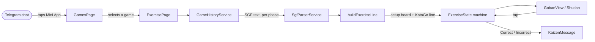

# ⛩️ Kaizen Mini App


### An interactive Go trainer, delivered as a Telegram Mini App.

The frontend for [Kaizen Companion](../kaizan-companion): users receive
KataGo-analyzed games through the Telegram bot, then open them here to drill
their biggest mistake against KataGo's recommended line, 101weiqi-style.

---

## 🥋 What it does

| Screen | Description |
| --- | --- |
| **GamesPage** (`/`) | Lists the user's analyzed games, grouped by phase (opening / middlegame / endgame), routes into an exercise per row. |
| **ExercisePage** (`/game/:gameId`) | The judged training loop: find KataGo's move, hold the line, Correct/Incorrect feedback with haptics. |
| **Next exercise** | From a finished exercise, steps forward through the same game's remaining phases without leaving the screen. |

---

## 💬 Opening an exercise — from tap to feedback



1. **List** — `GamesPage` renders the user's games from `GameHistoryService`.
2. **Load** — Selecting a game routes to `ExercisePage`, which fetches that game's per-phase SGFs and builds a `LoadedExercise` collection (opening/middlegame/endgame, whichever phases parse).
3. **Parse** — `SgfParserService` + `buildExerciseLine` turn one phase's SGF into a setup board, the user's/opponent's colors, the actual mistake move, and KataGo's recommended continuation.
4. **Play** — Tapping a point runs legality + correctness checks in the `ExerciseState` machine; wrong answers get precise feedback (the real game's move vs. any other wrong move), correct ones advance and trigger the opponent's scripted reply.
5. **Finish** — After the line is held, `onDoneSecondary` either advances to the next phase in the collection or returns to `GamesPage`.

---

## ⚙️ Under the hood

- **Shudan/Preact isolation** — The board renders through `@sabaki/shudan` (a Preact component) behind a dedicated adapter, kept outside Angular's own change detection.
- **Pure state machine** — `ExerciseState` + its reducers (`playVertex`, `undo`, `resetExercise`, …) are plain functions with no framework dependency, independently unit-testable.
- **Mock-data convention, explicitly isolated** — There is no real backend endpoint yet. `games_test/` fixture SGFs encode "KataGo's line / the real mistake / other wrong answers" as sibling branch order — a convention documented (and contained) in `exercise-line.ts`, never assumed to be a real contract guarantee.
- **One-provider backend swap** — `GameHistoryService` is an abstract class; swapping the mock for the real HTTP-backed implementation is a single provider change in `app.config.ts`, nothing that injects it needs to change.
- **Graceful outside Telegram** — `TelegramService` falls back to sane defaults (dark theme, no BackButton, no haptics) so local development works unmodified outside a real Telegram WebView.
- **Reusable judged screen** — `ExercisePage` is built so a future `/practice` session mode can drive several exercises through the same screen by rebinding its `gameId` input, instead of owning a fixed id itself.

---

## 🧰 Stack

| Layer | Technologies |
| --- | --- |
| **Framework** | Angular 20 (standalone components, signals) |
| **Board** | `@sabaki/shudan` (rendering, via Preact), `@sabaki/sgf` (parsing), `@sabaki/go-board` (rules/legality) |
| **Platform integration** | Telegram Mini Apps SDK (`telegram-web-app.js`) |
| **Language** | TypeScript 5.9 |
| **Testing** | Karma, Jasmine, Chrome Headless |
| **Hosting** | Vercel (static SPA) |

---

## 📁 Project structure

```
src/app/
  board/      Shudan/Preact adapter + board theming (goban-theme.scss)
  core/       TelegramService, ThemeService, SafeAreaService
  data/       GameHistoryService (mock implementation today)
  games/      GamesPage — the main menu / game list
  exercise/   ExercisePage, its state machine, and child components
  sgf/        SGF parsing helpers
  shared/     Decorative/shared pieces (paper background, waves, stone dot)
games_test/   Placeholder SGF triplets (opening/middlegame/endgame) used as
              mock data until the real backend endpoint exists
docs/
  design-handoff/kaizen-handoff/HANDOFF.md   Design source of truth
  backend-contract/                           Backend contract notes (read-only
                                               audit of the existing backend;
                                               no new endpoints implemented here)
```

---

## 📨 Running it locally

```bash
npm install
npm start          # ng serve, http://localhost:4200
```

Outside a real Telegram WebView, `TelegramService` falls back to sane
defaults (dark theme, no BackButton, no haptics) so local development works
unmodified.

### Build & test

```bash
npm run build       # production build, output in dist/kaizen-app/browser
npm test            # ng test, Karma + Chrome Headless
```

When testing manually, prefer a production build (`ng build` + serve
`dist/kaizen-app/browser`, or `ng serve --configuration production`) over the
raw dev server — the unminified dev bundle is noticeably larger and will feel
slower for reasons that have nothing to do with the app's actual runtime
performance.

---

## 🗂️ Mock data

There is currently no backend endpoint exposing analyzed games to a browser
client. `GameHistoryService` is built against a mock backed by the fixture
SGFs in `games_test/`, shaped to match the real backend's `GameHistoryDto`
record (`id`, `correlationId`, `openingAnalysed`, `middlegameAnalysed`,
`endgameAnalysed` — each `*Analysed` field is raw SGF text for that phase).
Swapping in the real endpoint once it exists should be a one-provider change.

The fixture SGFs don't tag which move is "the mistake" or which continuation
is "KataGo's line" — that distinction is a mock-only convention documented in
`src/app/exercise/exercise-line.ts`, not a real contract guarantee.

---

## 🚀 Deployment

Target host is Vercel (static SPA). `vercel.json` is already set up:

```json
{
  "buildCommand": "npm run build",
  "outputDirectory": "dist/kaizen-app/browser",
  "rewrites": [{ "source": "/(.*)", "destination": "/index.html" }]
}
```

No SSR is configured — this is a plain client-side Angular build (confirmed:
no `server.ts`/`main.server.ts`, no `server` architect target). The rewrite
exists for the Angular Router already wired in `app.routes.ts`.

`package.json` pins an `engines.node` range matching Angular CLI 20's own
requirement (`^20.19.0 || ^22.12.0 || >=24.0.0`) — set the same Node.js
version explicitly in the Vercel project's settings to avoid a mismatch with
Vercel's own default.

Going live still needs explicit approval each time — this repo is set up for
deployment, not deployed on its own initiative.

---

## 🧩 Known quirks

- `@sabaki/sgf` unconditionally requires Node's `fs` (and optionally
  `iconv-lite`/`jschardet`) in a code path this app never exercises. `fs` is
  stubbed via a local `vendor/empty-fs` package referenced in
  `package.json`, and a `postinstall` script
  (`scripts/stub-sgf-node-deps.js`) patches the two nested optional
  dependencies after every `npm install`. All three stubs are trivial empty
  modules — see `vendor/`.
